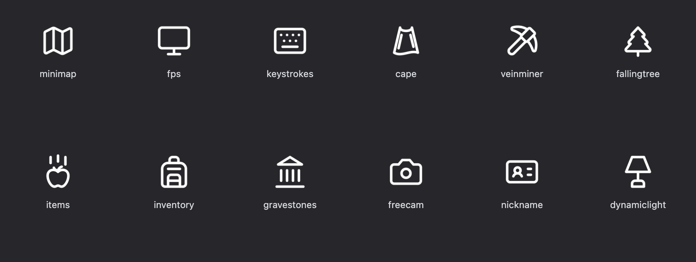
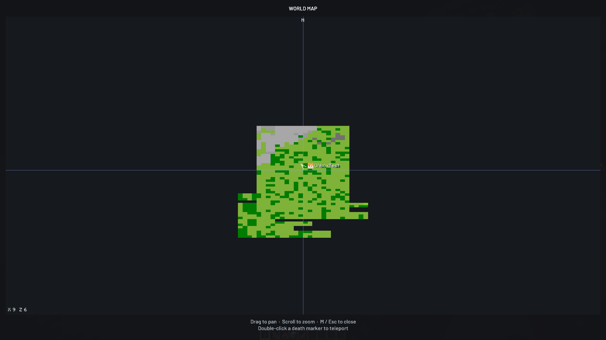
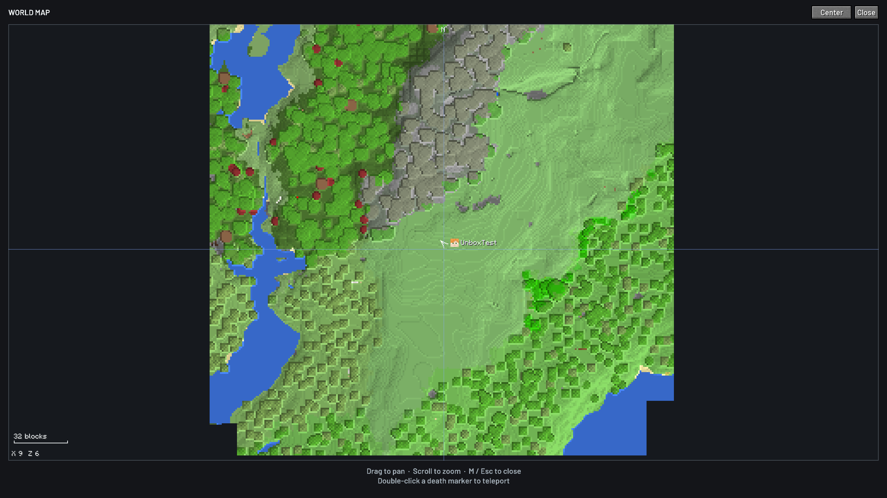
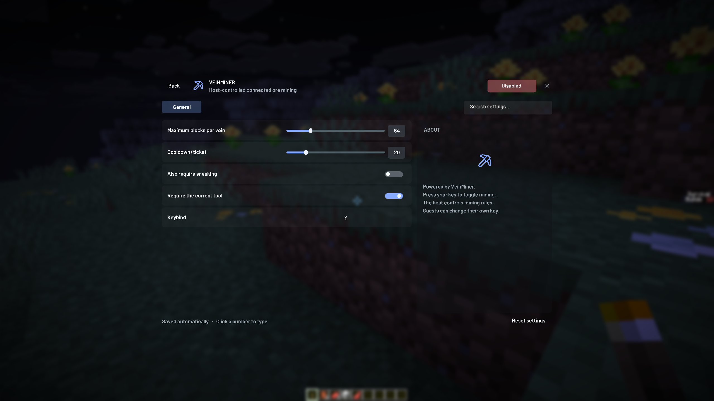

# 地图与生存交互优化

2026-10-16。本轮范围：图标清晰度和风格、删除自动上坡、连锁挖矿切换按键、地图显示与刷新。按用户要求保留 ItemPhysic Lite 的依赖版本、配置和运行逻辑。

## 图标与自动上坡

- 原有图标保持原 SVG 造型，重新渲染为 384×384，补齐平滑采样元数据。Logo 保持原始路径和 768px，姓名徽章仍为 96px。
- 连锁挖矿与砍树改用相同线宽、圆角端点的 Lucide Pickaxe / TreePine，删除程序逐像素画线的旧特例。
- 苹果及三条下落线保留原路径。
- 删除 Smooth Step 的模块目录、Mixin 和图标。旧配置残留不会再改变玩家跨越高度；原版 Auto Jump 设置独立保留。

## 连锁挖矿

接入上游 VeinMiner Hotkey 自带的 toggle 按键。原来 Unbox 错接的是 hold 按键。

- 按一下开启挖矿模式，松开仍开启；再按一下关闭。
- 初次迁移沿用原快捷键（默认 Y）；已有原生 toggle 自定义键会保留。
- 解绑旧 hold，防止第二次按下时又被 hold 逻辑激活。
- 右 Shift → VeinMiner → Keybind 仍可改键。
- 房主关闭、断线后清除模式；菜单中的按键不在关闭菜单后补触发。
- 保留原房主规则与公共服务器禁用策略。

## 地图

参考 [Xaero's Minimap](https://modrinth.com/mod/xaeros-minimap) 与 [Xaero's World Map](https://modrinth.com/mod/xaeros-world-map) 的地形层次、北向地图、坐标栏、鼠标平移缩放和标记交互。查阅时 Modrinth 页面分别显示约 1.182 亿、1.035 亿累计下载。Unbox 继续使用自己的实现和资源。

原实现将整张画面压缩成 128×128，移动后清空，分多个 tick 重画；地形扫描绕完整个渲染距离才回到附近。现在改为：

- 每个世界方块保留一个地图采样点，128×128 区域纹理组成地图。扩大窗口不会把整张地图限制为 128×128。
- 地图位置随渲染帧更新；拖动和缩放直接变换已缓存纹理，不清空地图。缩放以鼠标所在地点为中心。
- 方块变化加入优先队列；附近九区块持续更新，外围探索独立推进。采样设定数量和时间预算，避免无界扫描。
- 使用地表高度、群系草地/树叶/水色与地形明暗。忽略草丛等非阻挡装饰，减少地图上的杂点。
- GPU 区域缓存最多 192 张，CPU 瓦片缓存 16,384 个，容纳最大视野及周边扫描；未完成读取的空瓦片不擦除已有画面。
- 修复同瓦片在待写期间被淘汰、重新捕获时覆盖未落盘像素的问题。
- M / 自定义键打开与关闭；滚轮缩放，拖动平移，Center / 空格回到玩家；保留十字定位线、死亡头像姓名、坐标与权限检查。
- 旧地图缓存保留；重新加载的地区会更新着色。未探索区域保持空白。

## 游戏实截图

前后截图来自同一测试世界的隔离副本，探索时间与覆盖范围不同，用于核对地形清晰度和显示方式，不用于证明帧率差异。

修改前：

修改后：

快捷键设置：

## 验证

详细结果与构建哈希见 `design/validation/map-polish-2026-10-16/verification.json`。

- 四组版本/加载器游戏测试分别通过 19、19、18、19 项；NeoForge 26.1 继续明确禁用上游不兼容的 IPN / VeinMiner。
- 游戏界面回归 139 项通过；启动器 `npm test` 42 项通过。四份测试 JAR 与本地应用资源哈希一致。
- 地图缓存两项独立回归通过，并在临时副本回退修复后分别确认失败。
- `map-refresh-red-01` 在旧实现明确失败于“小幅拖拽立即响应”断言。
- `scripts/test-vein-toggle.py` 使用真实上游按键类，分别验证 Fabric 2.10.3 / NeoForge 2.10.1 的默认键迁移和已有自定义键，共四组。
- 隔离世界游戏测试验证真实加载器 Mixin 下的切换按键、实时地图更新、缩放定位、死亡点权限和地形存储；同时回归原有墓碑及生存模组流程。
- 测试使用存档副本和离线测试身份，不改玩家原存档。离线身份的官方服务 401、无 Controlify 的可选依赖提示属于测试环境日志。

## 地图性能对照

同一存档副本、固定视角、Fabric 26.1、渲染距离 12、2560×1440，开启小地图；预热 30 秒后采样 45 秒。两轮均为前台运行（inactiveFrames = 0）。

| 指标 | 修改前 | 修改后 |
|---|---:|---:|
| 平均 FPS | 740.283 | 726.685 |
| 1% Low FPS | 206.589 | 214.469 |
| P95 帧时间 | 3.011 ms | 2.981 ms |
| P99 帧时间 | 3.344 ms | 3.309 ms |

平均帧率约下降 1.84%，1% Low 约上升 3.81%。本机单次静止场景未发现明显退化；这不是低性能设备、移动探索或大型整合包的普遍性能结论。原始结果见验证目录中的 performance-before.json / performance-after.json。

## 本地交付

本地调试应用：`src-tauri/target/debug/bundle/macos/Unbox Client.app`。需要保存退出游戏、完全退出旧启动器，再打开这个应用并 Launch，才能加载新版 JAR。

本轮未发布 GitHub Release，版本号与公开更新渠道仍为 0.2.7。没有 Windows 游戏实玩或两台异地电脑测试。
