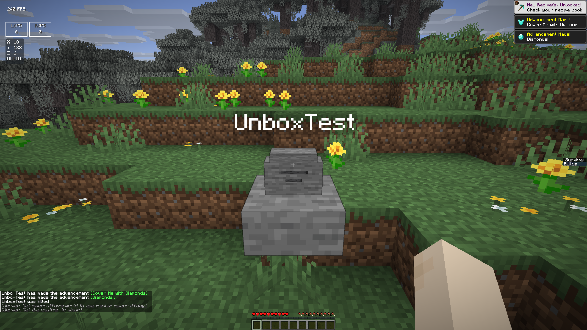

# 墓碑模型与 Freecam 原版飞行

2026-10-16。本轮仅处理墓碑外观及 Freecam 移动。保留既有公共服务器限制、房主规则和快捷键设置；未修改 ItemPhysic Lite、地图或启动器布局。

## 墓碑

模型由原版石台阶底座、石质竖碑、收窄碑顶及双面刻痕组成，总高度小于一格。姓名继续使用原版 TextDisplay。模型部件使用六个 BlockDisplay，不注册新的方块或实体类型。

Unbox 的选中和碰撞形状与底座、竖碑轮廓一致，指向碑身即可挖掘，碑身两侧空隙不会被当成整块石头。硬度保持石头的 1.5，普通石台阶仍保持原来的形状和硬度 2。

旧存档墓碑在名牌实体加载后自动转换。六个显示实体成功创建后才替换石头锚点，模型 UUID 与完整 ItemStack 一起保存；原所有者、姓名和物品组件保留。挖掘成功后移除底座、模型及姓名，物品按原规则掉落。延后加载的模型部件会检查墓碑存储记录并清理，避免回收后残留模型。

普通原版客户端可通过原版协议接收石台阶和展示实体；其选择/碰撞仍为原版台阶，因此需挖底座。Unbox 客户端支持直接挖碑身。本轮没有重新进行两台电脑的原版访客实测。

## Freecam

旧实现每 tick 直接增加固定位置，普通速度 0.35、冲刺速度 1，并将水平和垂直一起归一化，缺少观察者的惯性及滚轮调速。

现在摄像机是独立的 LocalPlayer，调用游戏自身的 `aiStep → applyInput → travel` 飞行流程，直接使用当前 Minecraft 版本的加速、水平/垂直阻尼、输入归一化、冲刺和双击前进逻辑。摄像机不加入世界实体列表；不调用原版发包 tick，能力更新不发包，玩家真实游戏模式不变。

- WASD 水平飞行，Space / Shift 独立升降；斜向升降不再削弱水平速度。
- 松键按原版阻尼减速并停止，冲刺触发和保持遵循原版逻辑。
- 滚轮使用原版 ScrollWheelHandler，保留离散滚轮选项、灵敏度与小数累积，每格调整 0.005，范围 0–0.2。
- 滚轮调整摄像机，不切换本体快捷栏；本体键盘输入清空，仍可看见本体。
- 自动疾跑模块在 Freecam 期间不注入冲刺，避免覆盖观察者原生按键行为。
- 原有快捷键设置及退出后恢复视角保留。Right Shift 详情补充滚轮说明。

## 验证

所有游戏运行使用 `.cache/benchmarks` 下的独立存档副本和离线测试身份。

| 目标 | 构建 | 实际游戏视觉/交互回归 |
| --- | --- | --- |
| Fabric 26.1 | 通过 | 74 项通过 |
| Fabric 26.1.2 | 通过 | 74 项通过 |
| NeoForge 26.1 | 通过 | 74 项通过 |
| NeoForge 26.1.2 | 通过 | 74 项通过 |

新飞行断言验证首 tick 0.049、连续加速、松键惯性/停止、四个朝向的 A/D、升降与斜向移动、冲刺保持、滚轮累积/上下限、身体位置及视角恢复。旧实现首先在首 tick 加速断言失败，改用原版移动后通过。

测试修正记录：初版 LocalPlayer 摄像机传入空连接导致构造失败，已改为仅供构造取 Profile 的现有连接，并隔离发包入口。独立方向用例需清空原版双击冲刺窗口；滚轮用例需设置其模拟的鼠标捕获状态，避免多个测试窗口争夺系统焦点。没有通过放宽数值误差或删除断言掩盖移动问题。

墓碑以 Fabric 26.1 和 NeoForge 26.1.2 分别执行两个 JVM 的保存/重启/取回测试，检查实际死亡、含组件和消失诅咒物品、旧 schema 转换、模型 UUID 不变、客户端命中范围、石头挖掘时间、非所有者拒绝、破坏与回收后的实体清理。原始报告及截图保存在 `design/validation/grave-freecam-2026-10-16/`。

启动器 Node 测试 42 项通过，配置导出一致性及 `git diff --check` 通过。本地 macOS ARM64 调试应用已重新打包，四份内置 JAR 与被测资源核对 SHA-256 一致。已有 skinview3d 大于 500 kB 的构建提示仍存在。

## 交付边界

本轮未发布 GitHub Release，未运行 Windows 或 Linux 游戏测试。测试包仍使用开发版本号 0.2.7。使用新版前保存退出游戏并完全退出旧启动器，再打开 `src-tauri/target/debug/bundle/macos/Unbox Client.app`。
