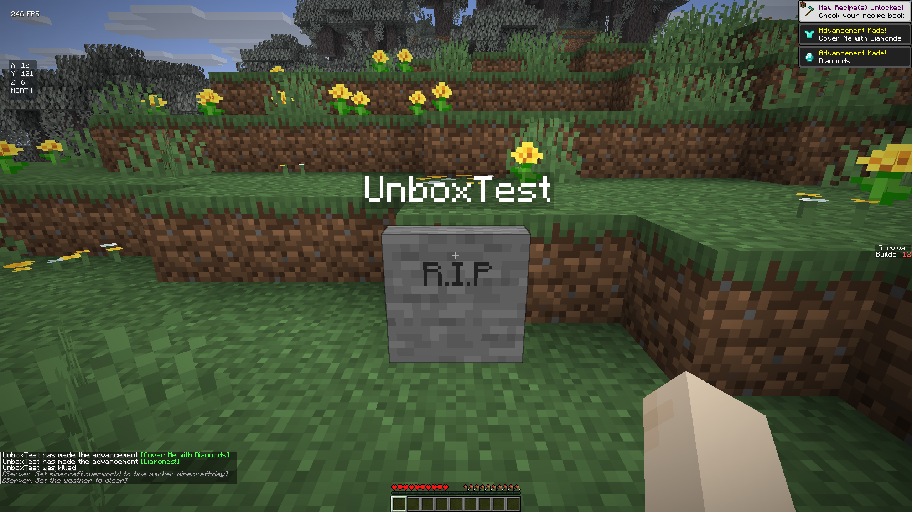

# 简洁 R.I.P 墓碑

2026-10-16，按用户后续要求替换上一版带底座墓碑。本轮仅修改墓碑模型及相关交互、迁移和验证，Freecam 保持上一轮实现。

- 石头纹理的矩形薄碑：宽 1 格、高 1 格、厚 1/4 格。
- 删除底座、收窄碑顶和刻痕；两面各显示黑色 `R.I.P`，文字不跟随视角转动、不带背景。
- 玩家姓名继续位于上方，存储和所有者权限保持不变。
- Unbox 的选择和碰撞为同尺寸薄矩形，前后没有遗留底座；挖掘速度和工具计算直接使用原版石头。
- 普通石头墓碑、上一版六部件台阶墓碑都在加载后自动转换，保留物品组件、所有者和姓名；旧部件全部清除。

模型使用一个石头 BlockDisplay 和两个固定 TextDisplay；不可见的原版 STRUCTURE_VOID 充当存储/挖掘锚点，仅在权威墓碑记录或同步名牌标记存在时覆盖选区、碰撞和挖掘速度。普通结构空位和台阶不受影响。未注册自定义方块/实体，但完整交互依赖 Unbox：原版客户端仍只有结构空位的默认中心选区和碰撞行为，本轮未验收原版访客交互。

## 草地生成位置修复

原逻辑只允许替换空气，脚边有短草时会向上寻找空气，导致墓碑高出地面一格。现在允许替换无碰撞、无液体且原版标记为可替换的植物，同时保留方块实体与现有墓碑保护。先确认姓名实体生成成功再替换植物，避免失败时额外清除草。

回归先在旧逻辑的短草用例中失败，修复后短草、蕨、高草、大蕨均优先选择脚下位置；石头、草方块、箱子、水和熔岩均不会被覆盖。真实死亡场景的墓碑从原来的 (9,122,3) 改为地面上的 (9,121,3)。这项修复作用于新生成的墓碑，不移动既有存储点。

## 验证与交付

- 26.1 / 26.1.2 的 Fabric、NeoForge 四份模块构建通过。
- Fabric 26.1、NeoForge 26.1.2 分别以两个独立 JVM 完成死亡 → 保存退出 → 重启 → 挖掘取回。
- 验证精确模型尺寸、两面的 R.I.P、真实世界碰撞查询、碑前空间无底座、两代旧模型迁移、模型 UUID 持久化、所有者权限及所有物品/实体清理；石头挖掘计时检查通过。
- 本地 macOS ARM64 调试应用构建通过，内置四份 JAR 哈希匹配；`git diff --check` 通过。
- 报告与截图：`design/validation/grave-tablet-2026-10-16/`。未发布 GitHub Release，未进行 Windows/Linux 游戏实测。
