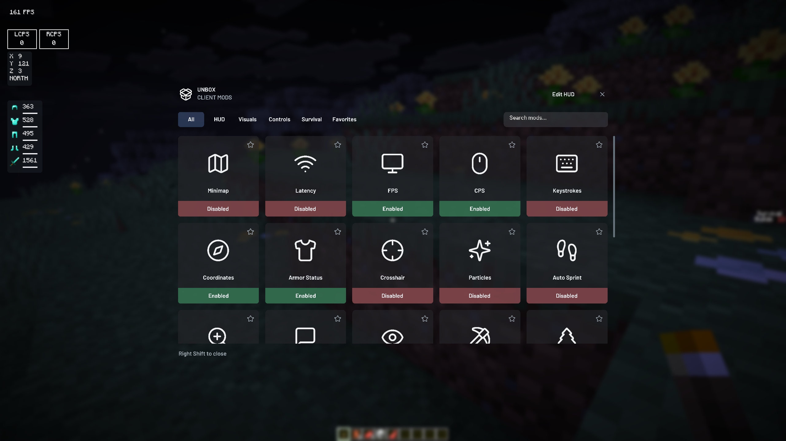
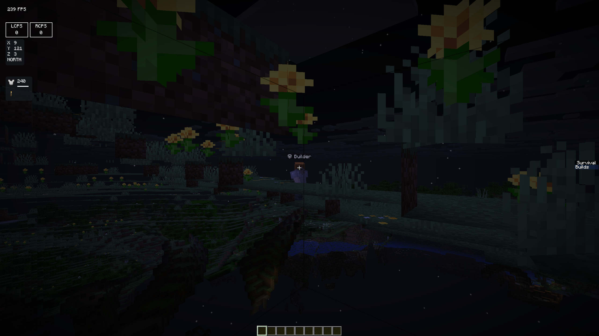

# Minecraft 26.3 原生适配与联机同步

日期：2026-10-16。新增 26.3，保留 26.1 / 26.1.2；Fabric 与 NeoForge 分别编译和安装原生依赖。启动器 Profile 布局、News 和共享世界目录方式不变。新建 Profile 可选择 26.3。

## 版本与实现

- Minecraft Java 26.3，Java 25，资源索引 34；官方客户端 SHA-1：`e877b6a07acd633fb3bb475002175cec036e7b87`。
- Fabric Loader 0.19.5 / Fabric API 0.163.0+26.3；NeoForge 26.3.0.86。
- 六个版本/加载器组合有明确 JAR 和依赖锁映射，不将未知版本回退到旧版。好友 Profile 只继承同版本、同加载器的个人客户端 JAR；个人按键和 HUD 保留。
- 26.3 的渲染、GUI、输入及实体 API 改动由 `scripts/prepare-version-sources.py` 在编译时适配，共用功能源码，不转换第三方模组 JAR。
- 快捷键保存为 Minecraft 稳定键名，迁移旧数字键码，同时保留玩家已有的自定义绑定。修复 SDL 鼠标按钮编号差异。
- Freecam 的独立相机实体使用独立 ID；兼容新的模型提交接口。墓碑修复 26.3 延迟挖掘分支计时，旧版及普通方块保持原路径。
- ItemPhysic Lite、IPN、VeinMiner、FallingTree、Wick 和性能模组使用各自 26.3 原生构建；具体版本、哈希和许可见 resources 锁文件与 THIRD_PARTY_NOTICES.md。

NeoForge 26.3.0.86 与 Sodium 0.9.2 的上游 mixin 不兼容，实际启动复现后改为官方 **0.9.3-beta.1**，搭配 Iris 1.11.7 完成启动、游戏和光影同步验证。Fabric 保持 Sodium 0.9.2。macOS 的 NeoForge 早期加载窗口存在 SDL 卡住问题，26.3/macOS 配置 `earlyWindowControl=false`，保留其他 FML 配置。

官方依据：[Minecraft 26.3](https://www.minecraft.net/en-us/article/minecraft-java-edition-26-3)、[Fabric 26.3](https://www.fabricmc.net/2026/09/15/263.html)、[Sodium 上游修复 PR 3948](https://github.com/CaffeineMC/sodium/pull/3948)。

## 联机实测

两个独立 Java 客户端、真实集成服务器、Direct LAN；账号与邀请使用本机 Cloudflare 兼容测试服务。访客初始没有 Profile 和房主玩法模组。

| 加载器 | 首次传输 | 文件 | 重启后加入 | 再次加入 |
| --- | ---: | --- | --- | --- |
| Fabric | 2,101,824 字节 | 玩法 JAR、材质 ZIP、光影 ZIP | 成功 | 0 字节，无需重启 |
| NeoForge | 2,101,943 字节 | 玩法 JAR、材质 ZIP、光影 ZIP | 成功 | 0 字节，无需重启 |

两组均验证：邀请创建匹配 Profile；加密登录阶段传输与原生缓存哈希校验；重启后真实物品注册和服务器交互奖励；材质包启用、Iris 光影实际启用；同名账号 UUID 隔离；拒绝冒充房主；队友死亡点与徽章；非管理员传送拒绝。每组房主 8 项、访客 9 项，另有公开流程 5 项检查。

证据：[Fabric 同步报告](../design/validation/version263-2026-10-16/fabric-sync.json)、[NeoForge 同步报告](../design/validation/version263-2026-10-16/neoforge-sync.json)。这是同机双客户端测试，未覆盖异地家庭网络、Windows 游戏实玩或两个微软正版账号。

线上好友 Worker 另行完成最小修改：只在现有部署的版本允许列表中加入 26.3。部署 ID `437a683eaffd450ebf9f6f847853a8ad`；重新读取源码确认与候选完全一致，健康检查 HTTP 200 / configured=true。未以本机账号测试代替线上端到端测试。

## 游戏与回归证据

- 26.3 两种加载器生存检查各 23 项通过：地图缓存与实时更新、墓碑草地放置/保存/死亡物品/28 tick 挖掘回收、ItemPhysic 苹果和石头真实模型提交、IPN 真实整理、VeinMiner 按键切换、FallingTree 原生事件。
- 两种加载器主菜单检查各 25 项通过，视觉与交互各 74 项通过，覆盖 Freecam、本体、模型旋转、昵称及皮肤。Fabric 完整 UI 检查 139 项通过，包括邀请接受/拒绝及确认后隐藏。
- Rust 65 项、前端 Node 43 项、Java 快捷键迁移 13 项通过。26.1 / 26.1.2 两种加载器重新编译通过；26.1 Fabric 实际游戏生存回归 23 项通过。
- 实测使用独立世界副本。26.3 世界升级确认仅由 `.cache` 内显式测试开关处理，不自动确认用户世界升级。





## 构建复现

先准备经官方清单校验的 `.cache/26.3.json` 和 `.cache/client-26.3.jar`，运行 `python3 scripts/prepare-game-runtime.py 26.3 --neoforge`。两个构建入口会调用 `prepare-version-deps.py` 按锁校验并准备编译依赖：

```sh
UNBOX_MINECRAFT_VERSION=26.3 sh scripts/build-mod.sh
UNBOX_MINECRAFT_VERSION=26.3 python3 scripts/build-neoforge-mod.py
```

Windows 工作流已增加两份 26.3 JAR 的下载与哈希校验输入，本轮未运行 Windows 构建。没有发布新的 GitHub Release；开发包版本号仍为 0.2.7。

## 本地交付

`npm run tauri -- build --debug --bundles app` 成功，包含前端 TypeScript 检查和生产构建。本地应用位于 `src-tauri/target/debug/bundle/macos/Unbox Client.app`，六份游戏模块与 resources 原件逐一核对 SHA-256 一致。[最终验证记录](../design/validation/version263-2026-10-16/verification.json) 包含哈希及检查计数。

生存验收 JAR 与最终 26.3 JAR 的逐文件比较只差 `UiSmokeTest.class`（修正测试夹具直接调用通知点击时的旧左键编号），生产类和资源完全一致。最终 Fabric JAR 已通过完整 UI 检查。此前失败日志保留在 `.cache`；修复后的成功报告另存，不覆盖失败记录。

启动器仍沿用开发版本号 0.2.7。本地新包需要完全退出旧启动器后再打开；其他测试者尚不能通过 GitHub 自动更新获得本轮功能。
