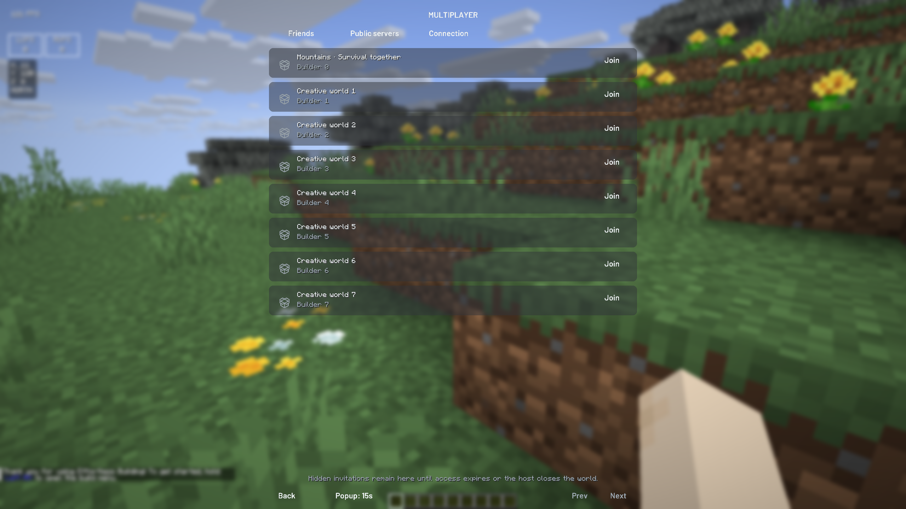
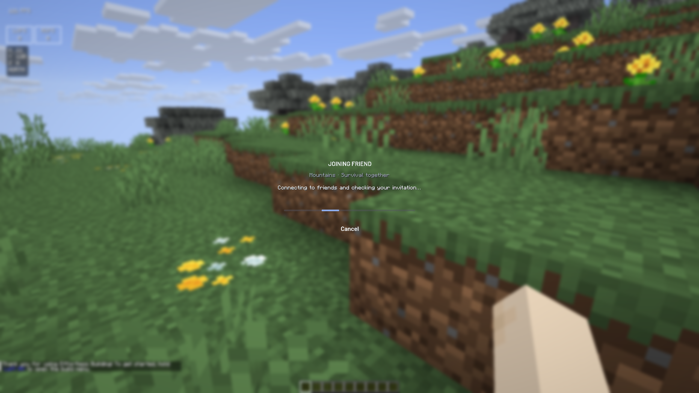
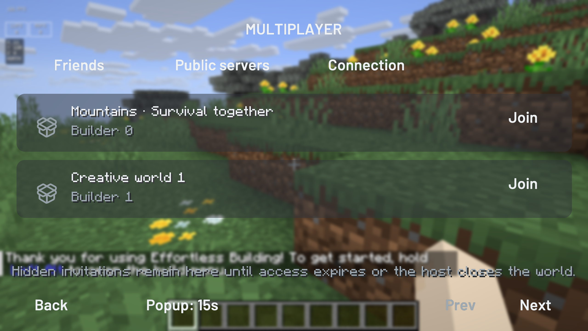

> 2026-10-20 发布补充：本轮内容已随 0.2.16 发布，联机轻量接口也已部署。下文保留开发阶段状态；最终发布证据见 [docs/57](57-0.2.16联机与性能更新发布.md)。

# 联机流程与异地测试

日期：2026-10-20。工作分支：`codex/multiplayer-flow`，基于上一轮性能优化提交 `1e0454a`。本轮尚未合并、发布安装包或部署 Cloudflare Worker。代码和打包覆盖 26.1 / 26.1.2 / 26.3 × Fabric / NeoForge；游戏实测平台为 macOS ARM64。

## 已改变的体验

| 问题 | 改动 |
| --- | --- |
| 邀请等约 10 秒才出现 | 原先完整同步约每 20 秒一次。增加鉴权后的邀请专用查询，每约 2 秒读取；完整账号、好友和资产同步仍按原周期运行。复用 HTTP 连接；轻量查询超时 3 秒。游戏与本地启动器桥接每 250 ms 检查，启动器界面每秒读取本地状态。不是即时推送，也不是到达时间保证。 |
| 接受后启动游戏，在标题页无反馈 | 启动信息携带邀请、账号与世界名称；游戏首次显示标题时识别自动加入任务，直接显示进度页。开始连接后沿用游戏连接页显示共享文件检查与下载进度。 |
| 游戏已加入，弹窗仍残留 | 启动器与游戏共享 `seenInvites`，所有加入入口都会标记已处理；自动重启时同样标记当前邀请。读状态和入服授权分开。 |
| 弹窗一直停留 | 默认 15 秒；游戏 Multiplayer 页面可选择 15 / 30 / 60 秒。启动器弹窗固定 15 秒。Hide 收起通知，不调用删除邀请接口。 |
| 收起后找不到世界 | 标题页 Multiplayer 打开好友世界列表，显示头像、世界名、房主和 Join；右 Shift 的好友区增加 Worlds 入口。长列表分页。 |
| 版本或共享内容不同直接关游戏 | 版本切换与共享模组／材质包／光影差异分别提示确认。确认前不下载差异文件、不创建重启请求；确认后复用缓存、准备环境、重启并自动加入。取消和断线会解除等待。 |
| 联机失败难以定位 | Multiplayer → Connection 可看连接路径、加入结果和游戏报告的延迟，保存本地诊断报告。 |

公开服务器入口保留在 Multiplayer 页面的 Public servers。离线账号可进入好友世界列表，公开服务器按钮仍禁用。微软账号的游戏多人权限继续决定公开服务器入口状态。

弹窗寿命与授权寿命是两个概念：弹窗 15 秒收起；现有服务端邀请授权仍为 5 分钟，房主关房、移除好友或授权到期后列表会移除世界。此轮没有扩大私密房间的访问权限，也没有让未被邀请的好友直接进入。

## 页面

以下是实际游戏截图，使用本地邀请夹具，不是真实玩家资料。








## 当前网络事实

当前 Unbox 实际路径为：同网段 UDP 验证 → LAN TCP 直连；不在同网段或验证失败 → e4mc 公网中继。`SocialBridge.init()` 明确关闭 e4mc 的 `dialtoneHostEnabled`。因此当前没有启用跨公网 P2P，不能报告 NAT 打洞成功率。

e4mc 依赖里存在 Dialtone / Iroh 的相关实现，但“依赖里包含 P2P”不等于 Unbox 已使用 P2P。后续如接入，必须同时记录底层实际直连／Iroh 中继状态；域名和本地连接成功不足以判断是否直连。上游项目：[e4mc 源码](https://github.com/vgskye/e4mc-minecraft-architectury)。

本轮不调整路由器、不自动部署收费中继、不开启未经异地及 Windows 验证的 P2P 路径。

## 测试结果

- 六组原生构建及打包验证通过；每组游戏内联机 UI 28 项检查，共 168 项。覆盖弹窗寿命与授权分离、隐藏后的世界列表、离线账号限制、重启确认、取消、确认中断线、自动加入标题状态及较大 GUI 比例。
- 标题入口另有 30 项实机回归通过。
- Rust 69 项通过；原有 Node 测试与新增服务端测试 59 项通过；独立启动器邀请交互测试 1 项通过；网络探测器 3 项测试通过。
- 两个本地测试身份、两个真实游戏进程：冷启动 → 内容差异确认 → 加密连接下载 → 原生准备 → 重启入服完成。下载共享模组、材质包和光影共 2,101,824 字节，验证了物品使用及服务端奖励；再次加入下载 0 字节、无需重启。
- 两轮真实 e4mc 公网中继双客户端入服通过。故意错误的邀请凭证被拒绝，正确凭证进入并持续游玩，房主可结束共享。仍是在同一台 Mac 上，不是异地实测。
- 第一轮游戏报告的 keepalive 延迟为 66 ms，第二轮为 140 ms。每秒观察到的值会重复，不是独立网络包样本，不能从重复值推断低抖动。
- 独立 TCP status/pong 公网探测 12 / 12 次成功，中位数约 202.3 ms，p95 / 最大值约 662.5 ms。它衡量重新连接后的 status/pong 路径，不等于既有游戏连接的延迟。测试期间存在多个游戏进程的资源竞争，不能将所有波动归因于网络。
- 探测器初版用协议号 -1 时，中继在 status 响应前断开；已改为有效协议号。26.1 / 26.1.2 使用 775，26.3 使用 777。

尚未验证：两个不同公网网络的连接与持续游玩、Windows 游戏运行、实际发布渠道上的邀请到达时间。微软与离线身份互邀的服务端回归通过；本轮双游戏实测使用两个离线测试身份，没有冒称重新验证正版登录流程。

## 玩家自己进行异地测试

### 设备与网络

1. 两台电脑使用相同测试版本。A 用家庭宽带，B 用另一家庭宽带或手机蜂窝热点，关闭手机的 Wi-Fi 回传。
2. 只在同一家庭 Wi-Fi 更换 IP，不算异地。单机双客户端、同一台电脑切 VPN、云机主动连接中继，可检查部分链路，但不能完整验证两个家庭 NAT 的穿透情况。
3. 如果暂时没有第二台实体电脑，可以在自己的另一处电脑远程操作；另一家庭网络＋自己的手机热点仍是最容易复现的方案。云机验证可作补充，需要现成且获授权的设备／额度。

### 每种组合的清单

| 步骤 | 观察并记录 |
| --- | --- |
| 房主邀请，访客只开启动器 | 邀请从点击发送到出现的秒数；不要记录账号密码。 |
| 放置弹窗超过 15 秒 | 弹窗消失；打开游戏 Multiplayer 仍有世界条目；能够加入。 |
| 访客游戏已开，双方内容一致 | 显示连接进度，直接加入；不重启、不重复弹邀请。 |
| 访客游戏未开 | 游戏首次标题应是加入进度，不是无提示的静止标题；最后自动进入。 |
| 双方版本不同 | 出现版本确认；取消后当前游戏保持；确认后只切换到匹配的原生加载器 Profile。 |
| 房主增加一个允许共享的测试模组／ZIP 材质包 | 访客看到差异确认；取消后不产生重启；确认后同步、重启、入服。再次加入不重复下载。 |
| 等待确认时房主关房或访客断网 | 不应永远停留在等待确认；能够返回并重新选择邀请。 |
| 已接受邀请并成功入服 | 游戏右下角和启动器均不应重新显示同一邀请。 |
| 持续游玩 5–10 分钟 | 测挖方块回弹、开箱响应、移动位置回拉、地形加载；进入 Connection 保存报告。 |
| 交换房主和访客 | 重复上述过程，以排查上行带宽或某一侧网络策略。 |

身份至少覆盖正版房主＋离线访客、离线房主＋正版访客；加载器分别测 Fabric 与 NeoForge。建议同一组合连续加入 10 次，分别记录成功、网络失败、用户取消、正常重启；不要把用户取消或预期重启算成网络失败。

收集每台电脑每个相关 Profile 的 `logs/unbox-network.json`，以及同步发生时的 `logs/environment-sync.json`。报告不写入账号名、UUID、世界名称、网络地址、邀请凭证或令牌。不同 Profile 的报告需一起保留；资源同步前后可能在不同 Profile 中。

### 可选的独立探测

有 Python 3.10+ 时，在访客电脑运行，房主保持世界共享：

```sh
python3 scripts/network-probe.py <房主的e4mc域名> --protocol 777 --count 30 --label home-to-hotspot --output network-probe.json
```

26.1 / 26.1.2 把 `--protocol 777` 改为 `--protocol 775`。工具只有标准库，Windows 与 macOS 均可运行；本轮只实测 macOS。它不登录游戏、不需要账号凭证，报告默认不包含目标地址。status 被关闭或中继不接受探测时，结果不代表游戏邀请必然失败，应以实际入服和游戏报告为准。

目前 **P2P 成功率不适用**；可计算的指标为：有效邀请入服成功率、冷启动/热加入耗时、中继建立耗时、游戏延迟、探测延迟与稳定性。异地数据返回后，才能决定是否接入并验证 Dialtone、选择更近的中继或优化同步吞吐。当前证据不足以保证低延迟。

## 上线注意

这轮只有本地分支与验证产物。上线顺序建议先更新 Worker 的兼容性接口，再发布启动器与六种游戏模块。旧 Worker 返回 Not found 时，客户端自动回到原有完整同步，不会让好友功能整体失效。

两秒轮询是减少等待的实现选择，会增加请求次数；轻量接口不取完整资产数据，但仍需数据库鉴权。按每个持续在线账号约 1,800 次轻量请求／小时评估实际免费额度。用户规模增大后，应升级为事件推送并保留断线补拉，不能把缩短轮询视作无限扩容方案。本轮未部署服务或开通付费资源。
