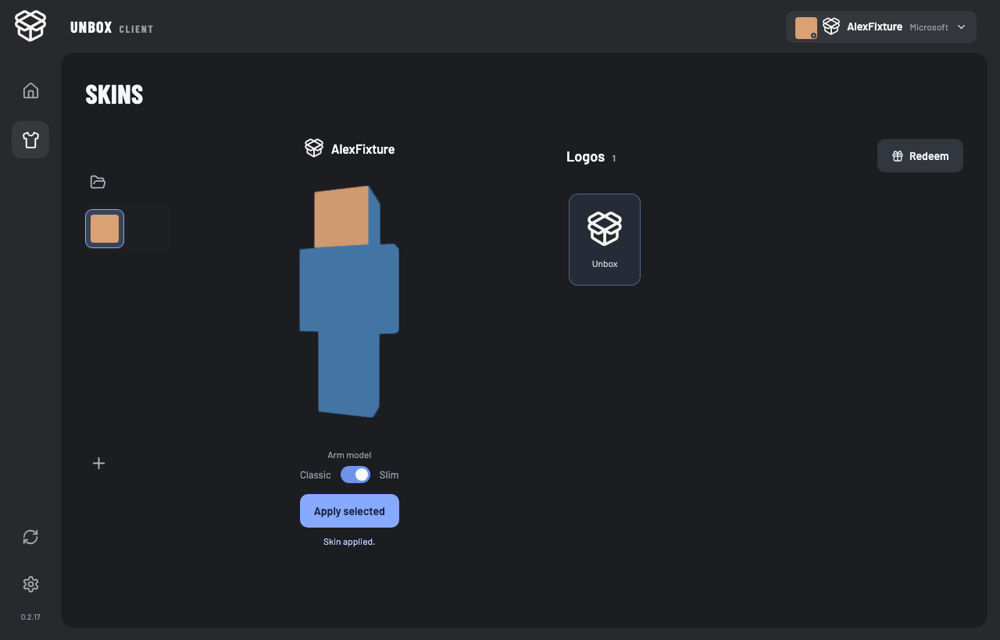
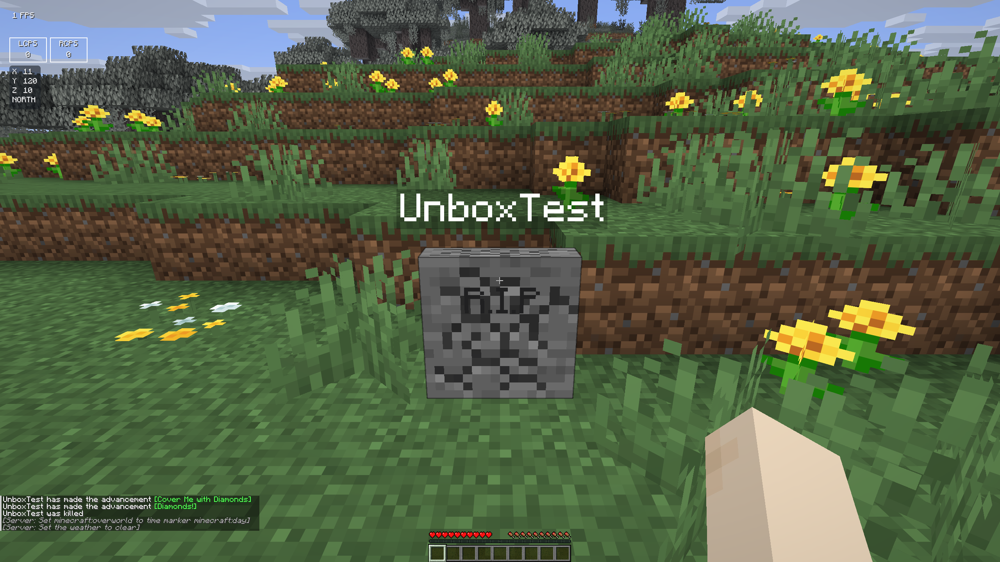

# 皮肤、更新入口与墓碑修复；启动器资源浏览调研

日期：2026-10-21。开发分支：`codex/skin-grave-updates`。本轮不发布 GitHub Release，不注册第三方 API、不部署新的代理服务。

## 本轮实现

- 更新入口常驻侧栏；无更新时为普通图标，有更新时显示蓝色圆形背景。进入后保留检查、日志、确认安装流程，安装前仍要求关闭游戏。
- 启动器皮肤库增加 Classic / Slim 滑块开关，先预览，Apply 后应用。已有皮肤可以直接切换手臂模型；原形态保留为可选皮肤。64×32 旧皮肤不支持 Slim。
- 游戏内皮肤库增加对应开关，通过启动器验证、上传或本地保存后应用；原有形态不会被覆盖。
- 正版账号已有自定义皮肤自动加入本机皮肤库；打开皮肤页刷新官方资料。每次上传新皮肤前再读取并保存官方当前皮肤，避免启动器缓存过期或别的启动器改过皮肤后丢失原图。皮肤下载失败时阻止覆盖并提示重试。
- 标题页衣服按钮打开 Unbox 换装页，支持返回标题页；未加载世界时使用原版玩家渲染状态显示人物。
- 墓碑的隐形锚点本来没有模型，原版破坏裂纹渲染会跳过。现在复用原版裂纹阶段和材质，将石头裂纹按墓碑尺寸压缩到 1×1×0.25；普通方块保持原来的渲染路径。取消挖掘或破坏完成后跟随原版进度消失。没有改变库存存储、挖掘时间、所有权或掉落规则。

## 调研结论

可以把模组安装做成启动器内的搜索、安装、启动。建议直接在现有 React + Rust 启动器中对接平台 API；Resourcify 继续负责游戏内资源浏览。

### 平台接入

| 项目 | Modrinth | CurseForge |
| --- | --- | --- |
| 搜索 / 详情 / 版本 | 公共 API 可用 | 第三方 API 可用，需为 Unbox 申请独立 API Key |
| 精确匹配 | 按 Minecraft 版本、加载器过滤文件 | 按游戏版本、加载器过滤文件 |
| 前置依赖 | 文件版本中有 required / optional / incompatible / embedded | 文件关系中有依赖类型，需要解析并确认兼容版本 |
| 下载校验 | API 提供文件 URL、大小、哈希 | 使用 API 返回的下载地址和哈希；尊重作者分发开关 |
| 当前核实 | 实际请求 26.1 Fabric 与 26.3 NeoForge 搜索成功 | 查阅官方 API 与条款；没有申请密钥或验证认证下载 |

搜索结果代表项目匹配，安装前仍须验证具体文件同时支持当前游戏版本和加载器。不能把项目同时支持两个条件误认为同一文件满足两个条件，也不能把 26.1 文件默认当作 26.3 文件。

CurseForge 的作者可以关闭第三方分发；这类项目应显示“Open on CurseForge”并提供手动导入，不能拼接 CDN 地址绕过。最新官方第三方条款还涉及密钥保密、缓存、代理和产品范围限制，实际接入方式需在 Unbox 的 API 申请中明确，不默认复用 Resourcify 的密钥或代理。

### 建议的玩家操作

1. 选 Profile → Mods → Browse；自动带入版本、加载器。
2. 搜索并看详情 → Install；展示模组及必须的前置依赖，一次确认。
3. 下载到临时位置，校验完成后一起安装；失败保留原环境并允许重试。
4. 游戏关闭时直接安装；运行中显示“Install after closing Minecraft”，不向已运行的 JVM 注入 JAR。
5. 完成后显示 Installed / Launch；更新显示变更和受影响依赖；卸载前提示被哪些模组依赖。

保留当前启动器托管的 Unbox、性能模组和核心前置，阻止另装同 ID 或不兼容版本。好友 Profile 的共享玩法依然以房主为准；个人安装入口不能悄悄覆盖它。资源包/光影可以共享文件缓存，但启用选择仍按现有 Profile 规则。不能承诺模组自动装好后一定无冲突；平台元数据无法覆盖全部运行时不兼容。

### Resourcify 能否放进启动器

现有项目已经有 `ports/resourcify` 原生移植。核实的上游版本是 `09a3fd32900cb6570c8ff2ad563272924faf7253`。它的 ProjectType 包含资源包、数据包、光影、世界和 UNKNOWN，没有普通 JAR 模组安装类型；没有现成的模组依赖安装器。

它可以继续在 Minecraft 内使用，但不能把 JAR 直接塞进 Tauri 就显示界面：Kotlin GUI 依赖 Minecraft Screen、UniversalCraft、纹理与游戏资源管理器；目录与版本来自 Platform 的游戏实例。启动器是 React / Rust，没有这些运行时。

若坚持复用其实现，需要抽离服务适配器、下载队列、取消和哈希验证，重做 Platform（显式传入 Profile 路径、版本、加载器），移除游戏 Screen / I18n / 纹理依赖，重新制作 React 界面，再另做 JAR 依赖解析和安全安装。保留 Kotlin 核心还需要额外 JVM 通信桥。因此工程上推荐参考交互、直接按官方 API 编写原生启动器功能，复用 Unbox 已有的目录、下载、校验与联机同步能力。

许可证经 Modrinth 项目 API、源文件头和 LICENSE.LESSER 交叉核实为 LGPL-3.0-only。根目录同时有 GPL 全文，是 LGPL 3.0 引用的基础条款，不能只看 LICENSE 第一行就误报为纯 GPL。若复制/改造其代码，修改部分保留许可证、源码与可替换要求；独立按公开 API 实现则不直接复制 Resourcify 代码。

建议顺序：先做 Modrinth 模组浏览和完整依赖安装，再统一 Packs / Shaders 的启动器浏览入口；CurseForge 在密钥及实际使用条款确认后接入。这一轮仅调研，尚未实现在线模组市场。

## 来源（2026-10-21 查阅）

- [Modrinth API / User-Agent / rate limits](https://docs.modrinth.com/api/)
- [Modrinth 搜索](https://docs.modrinth.com/api/operations/searchprojects/)
- [Modrinth 版本、依赖、文件哈希](https://docs.modrinth.com/api/operations/getversion/)
- [CurseForge REST API](https://docs.curseforge.com/rest-api/)
- [CurseForge 第三方分发开关](https://support.curseforge.com/support/solutions/articles/9000207877-project-distribution-toggle)
- [CurseForge 第三方 API 条款](https://support.curseforge.com/support/solutions/articles/9000207405-curseforge-3rd-party-api-terms-and-conditions)
- [Resourcify 源码](https://github.com/DeDiamondPro/Resourcify)
- [Resourcify LGPL 条款](https://github.com/DeDiamondPro/Resourcify/blob/master/LICENSE.LESSER)

## 验证

- 最终六份原生模块构建通过：26.1 / 26.1.2 / 26.3 × Fabric / NeoForge；内嵌资源、哈希与对应源码包校验通过。
- Rust 后台测试 71 项通过；Node / 无界面 Chromium 测试 62 项通过，覆盖皮肤保存、手臂预览/确认/恢复和常驻更新入口；最终细节修正后另跑相关 UI 回归 9 项通过。TypeScript / Vite 构建通过。
- 在用户要求静默测试之前，macOS 上 Fabric 26.1、NeoForge 26.3 标题导航各 30 项通过，衣服入口进入自有 SkinLibraryScreen。人物在未进世界时可渲染；随后补上的标题页全景背景仅重新编译，未再次启动游戏检查画面。
- 同样在静默要求之前，两组墓碑独立 JVM 写入/重启读取通过：物品保留、所有权、原生挖掘计时、掉落及清理通过。裂纹截图通过测试代码注入原版阶段 2 / 7 / 清除事件，确认纹理随阶段改变、贴合薄碑并能消失；服务器实际挖掘计时另行验证，不把注入事件称作鼠标操作实测。
- 收到静默要求后不再启动游戏、不切换前台；后续仅后台测试与构建。
- 26.3 首次墓碑测试误用了旧版本测试世界，停在升级提示，终止后改用原生 26.3 测试世界通过。没有使用或修改用户存档。
- 未进行 Windows 游戏实玩、真实微软账号皮肤上传或 CurseForge 认证下载。已有自定义皮肤会保存；没有自定义皮肤的账号不会额外生成原版默认皮肤 PNG 条目。

证据目录：[测试记录及截图](../research/verification/2026-10-21-skins-graves/)。截图中的皮肤、账号与墓碑属于测试夹具。

