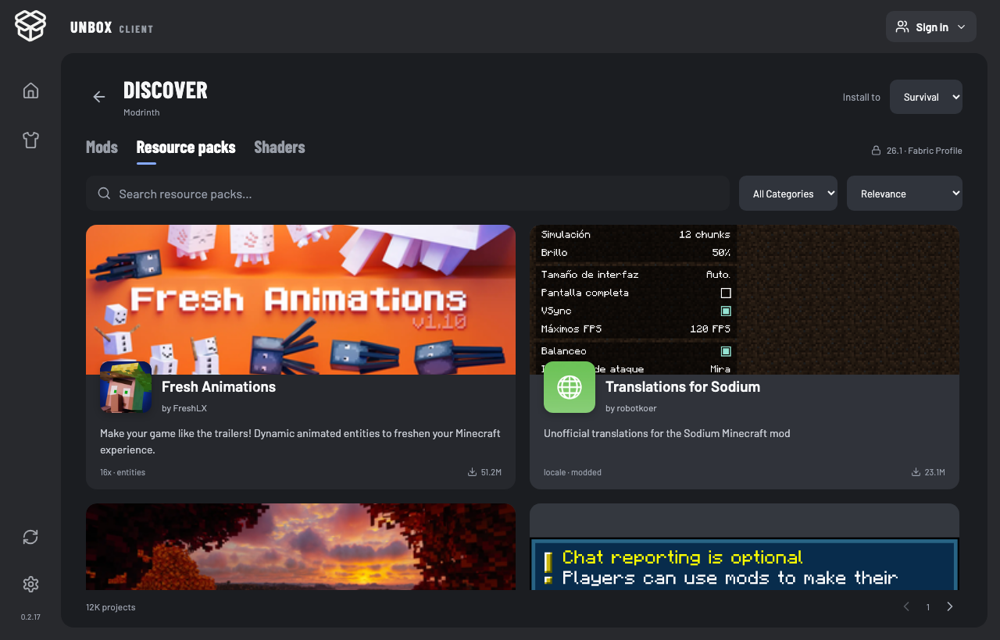

# Modrinth 资源市场与安装

2026-10-21 · 分支 `codex/modrinth-market`。延续上一轮皮肤与墓碑修复；本轮未发布 GitHub Release。

## 使用路径

1. 主页选择自己的 Profile，在 Mods / Packs / Shaders 列表右上角点 `+`。
2. 进入 Discover，默认锁定该 Profile 的游戏版本。模组同时锁定 Fabric / NeoForge，光影按 Iris 筛选，材质包按游戏版本筛选（材质包本身不依赖模组加载器）。右上角可改选自己的另一个 Profile，环境条件随之更新。
3. 搜索、选择一个简单分类、按相关性 / 下载量 / 更新日期排序。卡片显示项目封面、图标、作者、简介、分类和下载量；无封面时使用中性占位，不伪造项目图片。
4. 点卡片检查版本与依赖。确认清单显示本体、必需前置、已经安装或 Unbox 已提供的依赖、总大小。可选依赖不自动加入。
5. 点击 Install，显示文件下载进度，可取消下载。全部校验完成后才写入 Profile，完成后 `View profile` 返回对应列表，显示项目名称及图标。
6. 材质包保留现有的共享本地资源库规则；下载后在 Minecraft 中选择启用。光影需要进入游戏的 Shader 设置启用。没有自动替换玩家当前画面设置。

好友联机 Profile 的 `+` 禁用并显示只读提示；不能通过市场选择、拖入、删除或恢复内容修改房主环境。后台读取 Profile 的 `sharedHost` 再次检查，不依赖按钮禁用。仍可从本地列表移除整个好友 Profile；这不会修改房主世界。

## 安装机制

- 官方 Modrinth v2 API，带 Unbox User-Agent，不使用第三方代理或密钥。不接 CurseForge。
- 搜索结果只是候选项目；安装前再次校验具体版本文件同时匹配精确游戏版本及加载器。没有匹配项便明确失败，不改用旧版本或另一个加载器。
- 优先稳定发布，缺少稳定版时使用项目提供的匹配预发布版本。版本号及 beta / alpha 标记会在确认清单中显示。
- 遍历 `required` 依赖并去重，处理指定版本依赖，拒绝冲突的精确版本约束及平台声明的不兼容组合；`optional` 不自动下载，`embedded` 由原始 JAR 携带。
- 根据已安装文件的 SHA-512 向 Modrinth 查询其项目/版本。内置依赖来自六组 Unbox 锁定清单；不会用市场文件覆盖自带功能、性能模组或前置。已存在同项目时显示已安装，本轮没有自动升级替换逻辑。
- 所有下载地址限制为 Modrinth 官方 HTTPS CDN；验证大小、SHA-512、JAR/ZIP 结构、文件名及重复模组 ID。每文件上限 512 MB，每次安装上限 1 GB / 64 个项目。
- 后端生成 15 分钟有效的安装计划，前端只提交计划 token。写入前再次检查 Profile 的只读状态、版本、加载器、文件快照及游戏状态。安装期间若游戏启动或环境改变，保留下载缓存并拒绝写入，需重新确认。
- 先下载至缓存，再在内容目录暂存，不覆盖现有文件。多文件写入失败时回滚本次文件和目录元数据；有中断日志时，下次安装检查或启动前恢复，若文件被用户改过则停止并提示。
- 下载取消会中止等待及数据读取，移除未完成文件；已校验的缓存可供重试。进入短暂的本地提交阶段后禁用取消，保证一致性。
- 图标和名称与下载文件的 SHA-512 关联。文件被替换后不套用旧项目资料；列表仅对有市场记录的文件额外校验，避免为全部非市场文件增加一次读取。

平台声明不能覆盖所有运行时冲突。未识别来源的手动 JAR 仍由原生模组 ID 重复检查保护，不能保证自动发现它与所有下载模组的行为冲突。必需依赖版本不满足时，当前实现拒绝安装并提示，不擅自改动已有模组。

## 验证

全部测试静默进行，没有启动 Minecraft、打开桌面软件或切换焦点。

- Rust 全量 78 项通过；Node / 无界面 Chromium 全量 64 项通过，追加取消下载检查后市场相关 3 项通过；TypeScript / Vite 构建通过。
- 原生后台真实请求官方 API、下载、SHA-512 校验、保存和列表图标读取：AppleSkin、Fresh Animations、Complementary Reimagined 均通过；最后复测 AppleSkin 的重复安装识别，确认不再生成下载项。
- 真实依赖链：Item Borders + Iceberg + Prism 三个文件一起安装，Fabric API 识别为自带，不重复下载。
- 真实负向检查：Waystones 在所测环境没有精确匹配文件，安装前拒绝。它不是依赖下载成功样本。
- 网络测试使用隔离、可丢弃的 26.1 Fabric Profile，不涉及玩家存档。首次本机环境代理 CONNECT 中断，测试进程去掉代理环境变量后直连通过；未修改系统代理或产品代理行为。
- 本地验证覆盖：版本/加载器错误、只读好友环境、游戏运行、文件快照变化、重复模组 ID、内置模组保护、损坏缓存、同名目标、事务中断恢复及取消标志。
- 无界面 UI：1000×720、1280×820、1920×1080，无横向溢出；选择目标 Profile、搜索/分类/排序、确认前不安装、失败重试、取消、回到列表并显示图标、好友只读通过。
- `real-packs.png` 使用真实搜索返回与 CDN 图片，12 张封面/图标加载成功。其余 UI 图片使用固定夹具，便于复现交互，不冒称是真实项目内容。

未进行第三方模组的游戏内运行验证、Windows 实玩，也未发布更新。六组环境规则复用现有 Profile 数据；市场不会让没有发布对应版本的第三方模组变得可兼容。

证据：[后台、界面与公网下载记录](../research/verification/2026-10-21-modrinth/)。

## 官方接口依据

- [搜索项目与筛选条件](https://docs.modrinth.com/api/operations/searchprojects/)
- [项目版本过滤](https://docs.modrinth.com/api/operations/getprojectversions/)
- [版本文件、哈希与依赖](https://docs.modrinth.com/api/operations/getversion/)
- [API 使用规范](https://docs.modrinth.com/api/)
